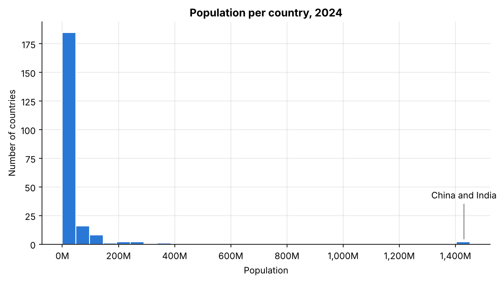
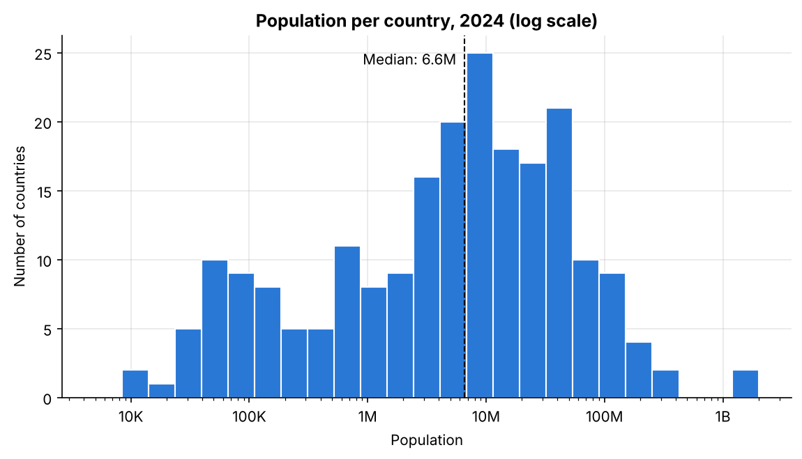
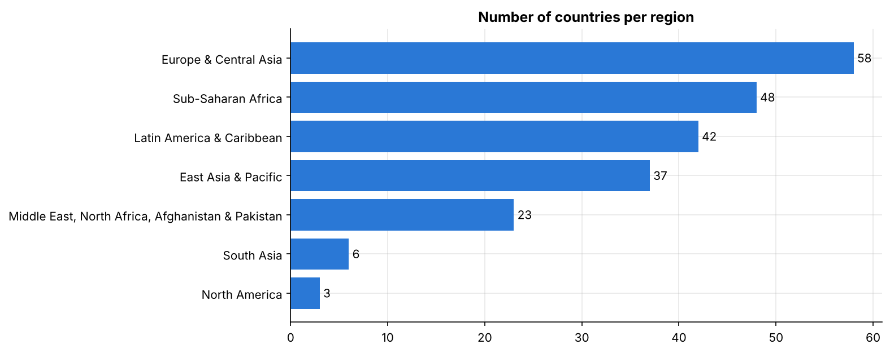
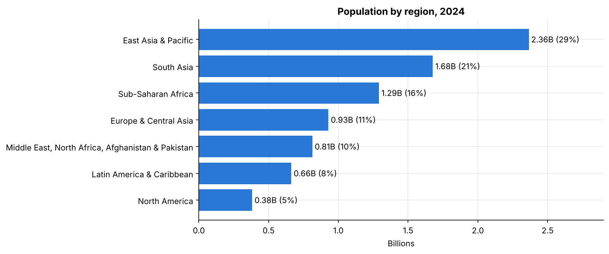
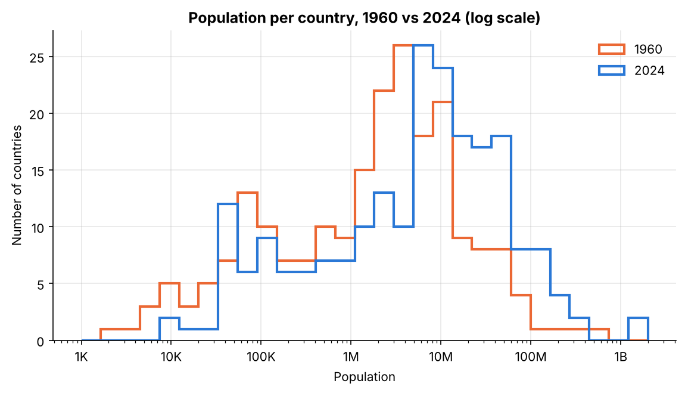
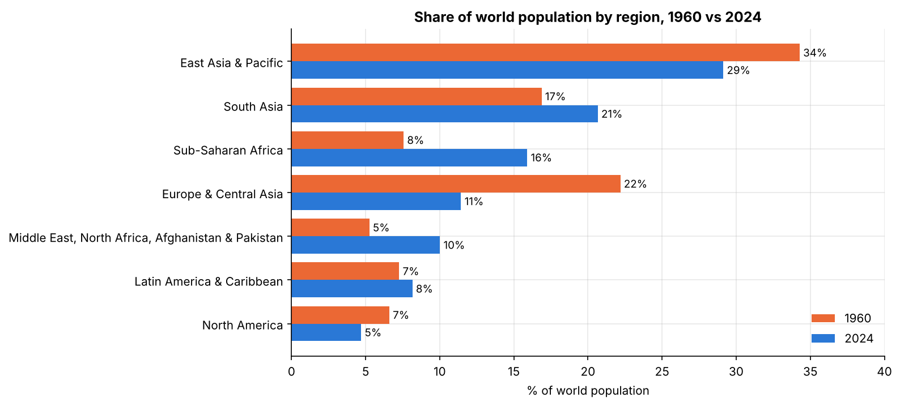

# PRODIGY_DS_01

Task 01 of the Prodigy InfoTech Data Science Internship: visualize the distribution of a categorical or continuous variable using a bar chart or histogram.

I looked at how population is distributed across countries in 2024, and how that distribution changed since 1960.

## Data

World Bank total population by country (SP.POP.TOTL), 1960-2024, plus country metadata (region and income group). I used the copy from Prodigy's [sample datasets repo](https://github.com/Prodigy-InfoTech/data-science-datasets/tree/main/Task%201). The notebook reads the files directly from there.

## What I did

- Removed 49 aggregate rows (World, Euro area, income groups, etc.) so people aren't counted twice. The remaining 217 countries add up to within 0.3% of the World total.
- Plotted the 2024 population per country as a histogram, first on a linear scale and then on a log scale.
- Made bar charts for number of countries per region, population per region, population by income group, and the top 10 countries.
- Compared 1960 with 2024 to see how the distribution and each region's share of the world changed.

## Charts

On a linear scale China and India squeeze almost every other country into the first bar:

A log scale shows the actual shape:

Comparing 1960 with 2024, the whole distribution moved right and the regional balance changed a lot:

## Findings

1. Country populations are very right-skewed (mean 37.4M vs median 6.6M).
2. On a log scale the distribution is roughly log-normal. Most countries have 1M-100M people and only 16 have more than 100M.
3. The 10 largest countries hold 57% of the world's population. India and China alone hold 35%.
4. South Asia has 6 countries and 21% of the population. Europe & Central Asia has 58 countries and 11%.
5. 73% of people live in lower-middle or upper-middle income countries.
6. Since 1960 the median country grew from 2.4M to 6.6M people. Europe & Central Asia's share of the world halved (22% to 11%) while Sub-Saharan Africa's doubled (8% to 16%).
7. 24 countries have fewer people than in 1990. 19 of them are former communist countries in Europe & Central Asia.

## Run it

Open `Task1_Population_Distribution.ipynb` in Google Colab or Jupyter and run all cells. Requires pandas, numpy and matplotlib.

## Tools

Python, pandas, NumPy, Matplotlib, Google Colab
